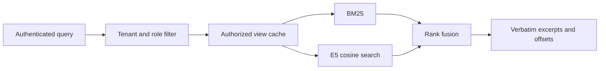

# EvidenceForge

EvidenceForge searches a JSONL corpus and returns ranked source excerpts. Each API key belongs to a tenant and carries a set of roles. The service filters documents before it builds a search index for that identity.

BM25 runs with the base install. The optional E5 encoder adds cosine retrieval and a hybrid mode that combines the two rankings with reciprocal rank fusion. See [the evaluation](execution_report.md) for results on the official SciFact test split.



## Run on Windows

Use Python 3.11 or later. These commands create a local environment, fetch the pinned SciFact files and run the baseline benchmark.

```powershell
py -3.12 -m venv .venv
.\.venv\Scripts\python.exe -m pip install ".[data,test]"
.\.venv\Scripts\evidenceforge.exe fetch --data data/scifact
.\.venv\Scripts\evidenceforge.exe benchmark --data data/scifact --output benchmark.json
```

Start the API from the same directory. The key below is for a local session.

```powershell
$env:EVIDENCEFORGE_CORPUS = "data/scifact/corpus.jsonl"
$env:EVIDENCEFORGE_API_KEYS = "local-review-key=public:reader"
.\.venv\Scripts\evidenceforge.exe serve
```

Send a query from a second PowerShell window. This example uses a claim from the public SciFact test split.

```powershell
$body = @{
  query = "0-dimensional biomaterials show inductive properties."
  mode = "bm25"
} | ConvertTo-Json
Invoke-RestMethod http://127.0.0.1:8000/query -Method Post -ContentType application/json `
  -Headers @{ "x-api-key" = "local-review-key" } -Body $body
```

On Linux or macOS, use `python3 -m venv .venv`, activate with `source .venv/bin/activate`, and run `pip install '.[data,test]'`. Use `export` for the environment variables and run `evidenceforge fetch` and `evidenceforge serve`.

## Enable E5

Install `.[dense]`, set `EVIDENCEFORGE_DENSE=1` and restart the server. By default it loads the pinned `intfloat/multilingual-e5-small` revision on CPU. Set `EVIDENCEFORGE_MODEL_PATH` to use a local copy of the checkpoint, and `EVIDENCEFORGE_THREADS` to change the CPU thread count.

```text
evidenceforge benchmark --data data/scifact --dense --output benchmark.json
```

Use `--model-path` with the benchmark to select a local checkpoint. The first dense search of a document view encodes its passages. Later queries reuse those vectors until the view is evicted or an import replaces the corpus.

## API behavior

- `GET /health` reports whether dense retrieval is configured.
- `POST /query` requires `x-api-key`. The response includes the requested and effective modes. Hybrid falls back to BM25 when E5 is disabled. An explicit dense request returns 503 in that setup.
- Each result includes the document ID, title, score and a verbatim excerpt. `start` and `end` are Unicode character offsets in the original document text. Cosine and RRF scores describe ranking. The `evidence_candidates` status leaves relevance and factual support open for review.
- `POST /ingest` requires `x-admin-token` and a configured `EVIDENCEFORGE_IMPORT_ROOT`. It validates an entire JSONL file under that directory before replacing the in-memory collection.

An API key mapping has the form `key=tenant:role|role`. Multiple mappings are comma-separated. The stock SciFact corpus uses tenant `public`. A scoped document can carry both `tenant_id` and `allowed_roles` at the top level. An administrator can also assign a collection-wide `policy` in an import request for a source with no per-document ACL. An empty role list grants access to all roles within that tenant. A tenant named `public` remains a separate tenant.

Imports require an explicit policy. For example, after setting the import root to `data/scifact`, an administrator can reload the published corpus with this request body.

```json
{"path":"corpus.jsonl","policy":{"tenant_id":"public","allowed_roles":[]}}
```

A replacement clears all cached views. An in-flight request uses the view it acquired at its start. Restarting reloads the file configured in `EVIDENCEFORGE_CORPUS`. Use a single process for the import demo and keep the server on loopback. [Security notes](SECURITY.md)

Ollama is optional. Set `OLLAMA_MODEL` and `OLLAMA_URL` before startup to enable draft generation with `generate: true`. The draft filter checks that bracketed citation IDs match the returned excerpts. Review the relationship between each claim and its source before using a draft.

## Tests and data

```text
evidenceforge fetch --data data/scifact
pytest -q
ruff check .
ruff format --check .
```

The tests use the published SciFact records and test judgments. They launch Uvicorn over loopback, send requests with different test identities and check excerpts against the original text. Set `EVIDENCEFORGE_TEST_DATA` to use an existing copy of SciFact. Set `EVIDENCEFORGE_TEST_MODEL` to the local E5 checkpoint for the dense HTTP test. That test uses the first 48 unchanged corpus rows to keep the CPU run short.

The benchmark fetches a fixed [corpus and query revision](https://huggingface.co/datasets/BeIR/scifact/tree/b3b5335604bf5ee3c4447671af975ea25143d4f5) and [test judgments](https://huggingface.co/datasets/BeIR/scifact-qrels/tree/2938d17dc3b09882fdb8c12bbbe2e2dc0e75a029) and verifies SHA-256 checksums before use. The data and model weights are downloaded separately. The application uses [Apache-2.0](LICENSE). See the [SciFact license](https://github.com/allenai/scifact/blob/master/LICENSE.md) and the [E5 model card](https://huggingface.co/intfloat/multilingual-e5-small) for upstream terms.
