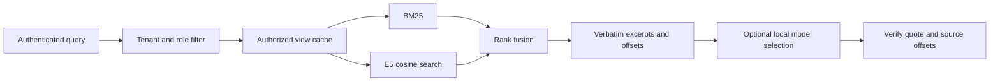

# EvidenceForge

EvidenceForge searches a JSONL corpus and returns ranked source excerpts. Each API key belongs to a tenant and carries a set of roles. The service filters documents before it builds a search index for that identity.

Version 0.3 adds transactional SQLite storage shared by local workers, request limits, operational logs and optional local model selection of exact quotations. The returned answer contains source text and a source ID. It does not fall back to unsupported model knowledge.

BM25 runs with the base install. The optional E5 encoder adds cosine retrieval and a hybrid mode that combines the two rankings with reciprocal rank fusion. See [the evaluation](execution_report.md) for results on the official SciFact test split.



## Run on Windows

Use Python 3.11 or later. These commands create a local environment, fetch the pinned SciFact files and run the baseline benchmark.

```powershell
py -3.12 -m venv .venv
.\.venv\Scripts\python.exe -m pip install ".[data,test]"
.\.venv\Scripts\evidenceforge.exe fetch --data data/scifact
.\.venv\Scripts\evidenceforge.exe benchmark --data data/scifact --output benchmark.json
```

Start the API from the same directory. The key below is for a local session.

```powershell
$env:EVIDENCEFORGE_CORPUS = "data/scifact/corpus.jsonl"
$env:EVIDENCEFORGE_API_KEYS = "local-review-key=public:reader"
$env:EVIDENCEFORGE_STATE = "data/state/corpus.sqlite3"
.\.venv\Scripts\evidenceforge.exe serve
```

Send a query from a second PowerShell window. This example uses a claim from the public SciFact test split.

```powershell
$body = @{
  query = "0-dimensional biomaterials show inductive properties."
  mode = "bm25"
} | ConvertTo-Json
Invoke-RestMethod http://127.0.0.1:8000/query -Method Post -ContentType application/json `
  -Headers @{ "x-api-key" = "local-review-key" } -Body $body
```

On Linux or macOS, use `python3 -m venv .venv`, activate with `source .venv/bin/activate`, and run `pip install '.[data,test]'`. Use `export` for the environment variables and run `evidenceforge fetch` and `evidenceforge serve`.

## Enable E5

Install `.[dense]`, set `EVIDENCEFORGE_DENSE=1` and restart the server. By default it loads the pinned `intfloat/multilingual-e5-small` revision on CPU. Set `EVIDENCEFORGE_MODEL_PATH` to use a local copy of the checkpoint, and `EVIDENCEFORGE_THREADS` to change the CPU thread count.

```text
evidenceforge benchmark --data data/scifact --dense --output benchmark.json
```

Use `--model-path` with the benchmark to select a local checkpoint. The first dense search of a document view encodes its passages. Later queries reuse those vectors until the view is evicted or an import replaces the corpus.

## API behavior

- `GET /health` reports the corpus revision, document count and configured capabilities. `GET /ready` returns 503 for an empty corpus or an unavailable configured model.
- `POST /query` requires `x-api-key`. The response includes the requested and effective modes. Hybrid falls back to BM25 when E5 is disabled. An explicit dense request returns 503 in that setup.
- Each result includes the document ID, title, score and a verbatim excerpt. The standard 280-character excerpt uses weighted coverage of distinct query terms, giving less weight to terms that repeat in that document. `start` and `end` are Unicode character offsets in the original document text. Cosine and RRF scores describe ranking. The `evidence_candidates` status leaves relevance and factual support open for review. Responses also include `corpus_revision`, `answer_source` and generation metadata.
- `POST /ingest` requires `x-admin-token` and a configured `EVIDENCEFORGE_IMPORT_ROOT`. It validates an entire JSONL file under that directory before replacing the in-memory collection.

An API key mapping has the form `key=tenant:role|role`. Multiple mappings are comma-separated. The stock SciFact corpus uses tenant `public`. A scoped document can carry both `tenant_id` and `allowed_roles` at the top level. An administrator can also assign a collection-wide `policy` in an import request for a source with no per-document ACL. An empty role list grants access to all roles within that tenant. A tenant named `public` remains a separate tenant.

Imports require an explicit policy. For example, after setting the import root to `data/scifact`, an administrator can reload the published corpus with this request body.

```json
{"path":"corpus.jsonl","policy":{"tenant_id":"public","allowed_roles":[]}}
```

A replacement commits a new revision and clears cached views. With `EVIDENCEFORGE_STATE` configured, requests in other processes reload the committed revision, and a restart uses the database rather than overwriting it with the startup corpus. A query whose revision changes while it is being processed receives 409 and must be retried. An already-sent response cannot be withdrawn. Without a state file, imports remain process-local and are lost on restart.

Use `evidenceforge serve --workers 2` for multiple workers on one host. The CLI requires a shared state file for that option. SQLite state belongs on a local disk; this is not a distributed database configuration. Keep the service on loopback or behind a correctly configured authenticated HTTPS proxy. [Security notes](SECURITY.md)

## Local source-grounded answers

Start a local llama.cpp server in a separate window. The integration was exercised with the official Qwen3-1.7B Q8_0 checkpoint and llama.cpp build 11476. Download the [model](https://huggingface.co/Qwen/Qwen3-1.7B-GGUF/tree/90862c4b9d2787eaed51d12237eafdfe7c5f6077) and [runtime](https://github.com/ggml-org/llama.cpp/releases/tag/b11476) separately; neither is bundled.

```text
llama-server --model Qwen3-1.7B-Q8_0.gguf --host 127.0.0.1 --port 18779 --ctx-size 4096 --parallel 1 --threads 4 --threads-batch 4 --reasoning off --alias evidenceforge-local
```

Set the following variables before restarting EvidenceForge, then request `generate: true` in `/query`.

```powershell
$env:EVIDENCEFORGE_LLM_PROTOCOL = "chat"
$env:EVIDENCEFORGE_LLM_URL = "http://127.0.0.1:18779/v1/chat/completions"
$env:EVIDENCEFORGE_LLM_MODEL = "evidenceforge-local"
```

The model receives numbered spans from at most three 800-character excerpts selected by query-term coverage, without reference answers. It returns one existing span ID, or an empty ID to abstain. The server retrieves the original quotation for that ID, checks its source membership and calculates offsets against the original document before returning `grounded_extract`. The model never transcribes the displayed answer. Invalid output is rejected; empty selections, truncation, timeouts, unavailable backends and busy backends have separate statuses. Correct quotation membership does not prove that a passage answers the question correctly; see the measured limitations in the evaluation report.

Generation is limited to one active request per shared SQLite database. Without a database, the limit applies within one process. The output budget is 64 tokens, the default read timeout is 90 seconds, redirects and environment proxies are disabled, and only loopback endpoints are accepted. There are no external API charges. A small local model still has latency and comprehension limits.

The Ollama protocol is retained as an optional adapter: set `EVIDENCEFORGE_LLM_PROTOCOL=ollama`, the URL to `http://127.0.0.1:11434/api/generate`, and the installed model name. This adapter was not executed against an installed Ollama service in this release. The live model evidence uses llama.cpp.

With SQLite enabled, accepted span IDs are cached for 300 seconds, up to 256 entries. The cache key includes the question digest, tenant and roles, corpus revision, source spans, endpoint, model and output-policy version. Raw questions and model prose are not stored in this cache. An import clears cached selections, and each hit is checked against the current sources. Set `EVIDENCEFORGE_LLM_CACHE_SECONDS=0` to disable it. Set `EVIDENCEFORGE_LLM_CACHE_VERSION` to the checkpoint revision when changing weights under an existing model name. Responses expose `generation.cached` and `generation.requires_review`; cached source selection still needs the same relevance review.

`python scripts/evaluate_generation.py path/to/test.json --cache-check --output local-cache.json` measures one real request, repeats it after an API restart, then restricts access and verifies that the answer is no longer returned. It measures an application-cache miss against an already-loaded model, not a cold model startup.

## Request and storage controls

Request bodies are limited to 16 KiB and ten seconds of body-reading time. Authenticated queries have a default fixed-window quota of 120 requests per key per minute, configured by `EVIDENCEFORGE_REQUESTS_PER_MINUTE`. With SQLite, counts are shared across workers. Clients receive 429 with `Retry-After` when over quota. These controls do not replace a reverse proxy's connection and abuse limits.

JSON audit records contain a server-generated request ID, route category, HTTP status and elapsed time. They omit queries, documents, answers and credentials. SQLite files contain the corpus and ACLs and must stay outside version control and shared folders. Back up the database with SQLite's backup mechanism rather than copying a live database file alone.

## Tests and data

```text
evidenceforge fetch --data data/scifact
pytest -q
ruff check .
ruff format --check .
```

The tests use the published SciFact records and test judgments. They launch Uvicorn over loopback, send requests with different test identities and check excerpts against the original text. Set `EVIDENCEFORGE_TEST_DATA` to use an existing copy of SciFact. Set `EVIDENCEFORGE_TEST_MODEL` to the local E5 checkpoint for the dense HTTP test. That test uses the first 48 unchanged corpus rows to keep the CPU run short.

[Citation-window comparison](reports/CITATION_EVALUATION.md): over 1,000 human-annotated PersianQuAD questions, a top-five citation contained a complete reference answer span in 736 cases, up from 410 with the released 0.3.0 wheel. Document ranks and scores matched exactly. The report includes the losses, latency tradeoff and commands to reproduce the comparison.

The operations suite starts independent HTTP server processes, imports the original SciFact corpus with an access-test policy, checks cross-process revocation and restarts from the saved database with the startup file unavailable. Other cases check shared quotas, request-size refusal and quotation attribution using original source text. Test identities and access policies are controls, not generated benchmark documents or labels.

For real model evaluation, configure the local endpoint above and run:

```text
python scripts/evaluate_generation.py path/to/test.json --limit 12 --output local-generation.json
```

This verifies the pinned publisher file, copies its contexts unchanged, samples evenly spaced human annotations and starts an actual HTTP service. Reference answers are used only for scoring. The output records failures as well as accepted quotations, controlled source-removal cases, concurrent requests and an unavailable backend. It contains publisher text; review upstream data terms before redistributing it.

The benchmark fetches a fixed [corpus and query revision](https://huggingface.co/datasets/BeIR/scifact/tree/b3b5335604bf5ee3c4447671af975ea25143d4f5) and [test judgments](https://huggingface.co/datasets/BeIR/scifact-qrels/tree/2938d17dc3b09882fdb8c12bbbe2e2dc0e75a029) and verifies SHA-256 checksums before use. The data and model weights are downloaded separately. The application uses [Apache-2.0](LICENSE). See the [SciFact license](https://github.com/allenai/scifact/blob/master/LICENSE.md) and the [E5 model card](https://huggingface.co/intfloat/multilingual-e5-small) for upstream terms.
